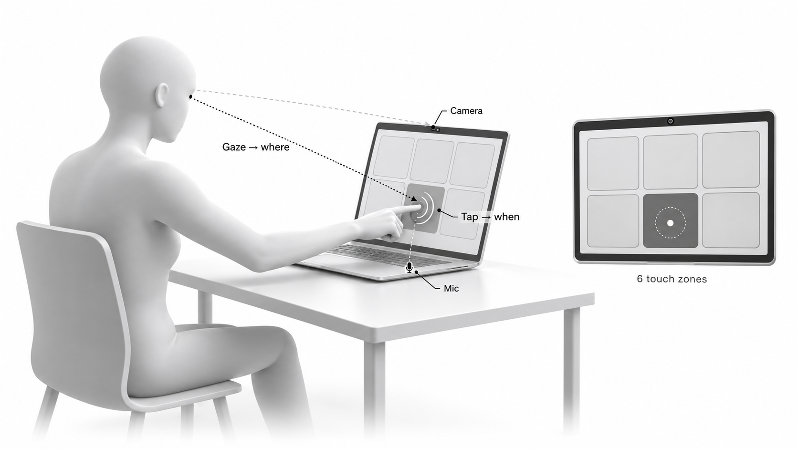

<div align="center">

# Magic Tap

**Touch input for a laptop screen that has no touchscreen.**<br>
Your eyes pick the button. The sound of your tap says when.<br>
Only your laptop's built-in camera and microphone, with no extra hardware.

[](LICENSE)
[](https://www.python.org/)
[](#requirements)
[](#requirements)
[](#how-it-works)
[](https://github.com/tashfeenahmed/magictap/actions/workflows/tests.yml)
[](https://github.com/tashfeenahmed/magictap/commits/main)
[](https://github.com/tashfeenahmed/magictap/stargazers)

[Quickstart](#quickstart) · [Integrate](#integrate-it) · [How it works](#how-it-works) · [Results](#results-so-far-one-user-not-a-controlled-study) · [Troubleshooting](#troubleshooting)

<br>



<sub>The camera follows your gaze to find <b>where</b>; the microphone hears the tap to know <b>when</b>.</sub>

</div>

## Quickstart

```sh
uv tool install git+https://github.com/tashfeenahmed/magictap   # installs the `magictap` command
magictap setup      # checks your Mac, then eye calibration (~6 min) and tap training (~2 min)
magictap buttons    # try it: look at a button and tap the screen on it
```

Don't have `uv`? Install it with `curl -LsSf https://astral.sh/uv/install.sh | sh`
([docs](https://docs.astral.sh/uv/)).

Every full-screen step waits for **Space** before it starts, and **Esc** quits.
Models download automatically on first use (~30 MB, plus PyTorch). Your
calibration and models are stored in `~/Library/Application Support/MagicTap`
(change it with `MAGICTAP_HOME`).

### From source

```sh
git clone https://github.com/tashfeenahmed/magictap && cd magictap
uv sync
uv run magictap setup
uv run magictap buttons
```

### Requirements

- A Mac laptop with Apple Silicon and its built-in camera and microphone, macOS 14
  or later (developed on an M4 Max). Optimized for laptops: it relies on the camera
  sitting just above the screen.
- Python 3.12 (`uv` installs it for you)
- Permissions for your terminal app, in **System Settings > Privacy & Security**:
  - **Camera** and **Microphone**: always needed
  - **Accessibility**: only for `magictap mouse`, which clicks for you

`magictap doctor` checks all of this and tells you what to fix.

## Commands

| Command | What it does |
|---|---|
| `magictap setup` | Guided first run: `doctor`, then `calibrate`, then `taps` |
| `magictap doctor` | Checks camera, mic, permissions, models and calibration |
| `magictap calibrate` | Eye calibration, plus touch rounds on a grid. Picks the finest grid that works reliably for you |
| `magictap taps` | Teaches it your screen taps vs. typing, talking and noise |
| `magictap buttons` | Big on-screen buttons with right/wrong feedback. Guided mode keeps learning as you use it |
| `magictap mouse` | Use it in **any app**: tap the screen and it clicks where you're looking |
| `magictap serve` | Local WebSocket service for **your app** (see below) |
| `magictap preview` | Camera view with the face and eye overlay, for checking framing |

## Integrate it

### Zero code: mouse mode

```sh
magictap mouse
```

Look at something and tap the screen on it, and Magic Tap clicks there. This works
with any app whose buttons are big enough (see *Results* for what "big enough" means).

### Your app: the local service

```sh
magictap serve      # ws://127.0.0.1:8765
```

Your app tells Magic Tap where its buttons are and gets an event when one is
tapped. Coordinates are **global screen points**, with the origin at the top left of
the main display.

| Direction | Message | Meaning |
|---|---|---|
| app → Magic Tap | `{"type":"targets","targets":[{"id":"next","x":1200,"y":300,"w":400,"h":300}]}` | Your buttons (replaces the previous set) |
| app → Magic Tap | `{"type":"subscribe","gaze":true}` | Also stream the gaze point (~15 Hz) |
| Magic Tap → app | `{"type":"hello","version":"0.2.0","screen":[1728,1117]}` | Sent on connect |
| Magic Tap → app | `{"type":"tap","x":1395,"y":452,"target":"next","confidence":0.92,"t":…}` | A tap: where you were looking, which of your buttons that is (`null` if none) and how sure it is (0–1) |
| Magic Tap → app | `{"type":"ignored","reason":"not a tap"}` | A sound that was rejected: `not a tap`, `unusual sound`, `keyboard/trackpad` or `eyes not on screen` |
| Magic Tap → app | `{"type":"gaze","x":…,"y":…}` | Only if subscribed |

**JavaScript** ([`clients/js/magictap.js`](clients/js/magictap.js), no dependencies):

```js
import { connect, screenRect } from "./magictap.js";

const mt = connect();                       // reconnects automatically
mt.setTargets([{ id: "next", ...screenRect(document.querySelector("#next")) }]);
mt.on("tap", (tap) => { if (tap.target === "next" && tap.confidence > 0.6) nextSlide(); });
```

**Python** (`magictap.client`):

```python
from magictap.client import MagicTapClient

client = MagicTapClient()
client.set_targets([{"id": "next", "x": 1200, "y": 300, "w": 400, "h": 300}])
client.on_tap = lambda tap: print(tap["target"], tap["confidence"])
client.run_forever()
```

**Examples**
- [`examples/web/`](examples/web): a full-screen page with six buttons. Run
  `magictap serve`, then `python3 -m http.server -d examples/web 8000` and open
  http://localhost:8000. Pages need to be served over http, because browsers block
  module imports from `file://`.
- [`examples/python_client.py`](examples/python_client.py): reports left or right half taps.

Any language with WebSockets works the same way, including Swift's
`URLSessionWebSocketTask`.

## How it works

- **Where: your eyes.**
  1. MediaPipe face mesh, with the face normalised for head pose.
  2. ETH-XGaze gaze estimation (ResNet-18).
  3. A per-user mapping to screen points, learned during calibration.
  4. While you touch the screen your gaze reads slightly high; Magic Tap learns that
     shift and subtracts it.
- **When: the tap sound.**
  1. 3 ms onset detection against an adaptive noise floor, with clips aligned to the
     exact sample of impact.
  2. A classifier trained on your taps vs. your everyday noises.
  3. An "unusual sound" check.
  4. Sounds within 150 ms of a key or trackpad press are ignored.
- **Fusion:** a tap is placed where your eyes were in the 0.3 s before it. If the
  gaze doesn't clearly agree, Magic Tap doesn't click.

[CONFIGURATION.md](CONFIGURATION.md) has the exact settings and what we learned
building it.

## Results so far (one user, not a controlled study)

| | |
|---|---|
| Gaze error on held-out dots | 83 pt median |
| Taps detected | 91–95 % |
| False taps from typing, talking, knocks and music | 0 of 73 |
| Live accuracy on a 3×2 grid of buttons | 81 % (26/32), before the latest fixes |

It's good for a handful of large buttons, not precise pointing. Accuracy depends on
calibrating in the posture, lid angle and lighting you'll use it in.

## Troubleshooting

- **Nothing happens / it never says "ready":** run `magictap doctor`. Camera and
  Microphone must be allowed for the app you run it from (Terminal, iTerm, VS Code…).
- **Wrong button:** recalibrate in the position you actually use. Keep text and camera
  previews out of the middle of the screen while calibrating; anything readable pulls
  your eyes away from the dots.
- **Taps not heard, or heard when you didn't tap:** run `magictap taps` again in the room
  you'll use it in. Tap with your fingertip; gentle taps work, but firm ones are more
  reliable.
- **Clicks in mouse mode don't happen:** allow Accessibility for your terminal app.

## Credits

- Gaze model: ETH-XGaze ResNet-18 weights by hysts
  ([ptgaze](https://github.com/hysts/pytorch_mpiigaze_demo), MIT). The 3D face template
  in `magictap/assets` comes from the same project; its licence is included.
- Face, pose and hand landmarks: [MediaPipe](https://github.com/google-ai-edge/mediapipe).
- Tap-detector ideas (short-window onsets, exact alignment, novelty rejection and learning
  from evaluation taps): [JustinGamer191/Holo](https://github.com/JustinGamer191/Holo) and its forks.

## License

MIT, see [LICENSE](LICENSE).
